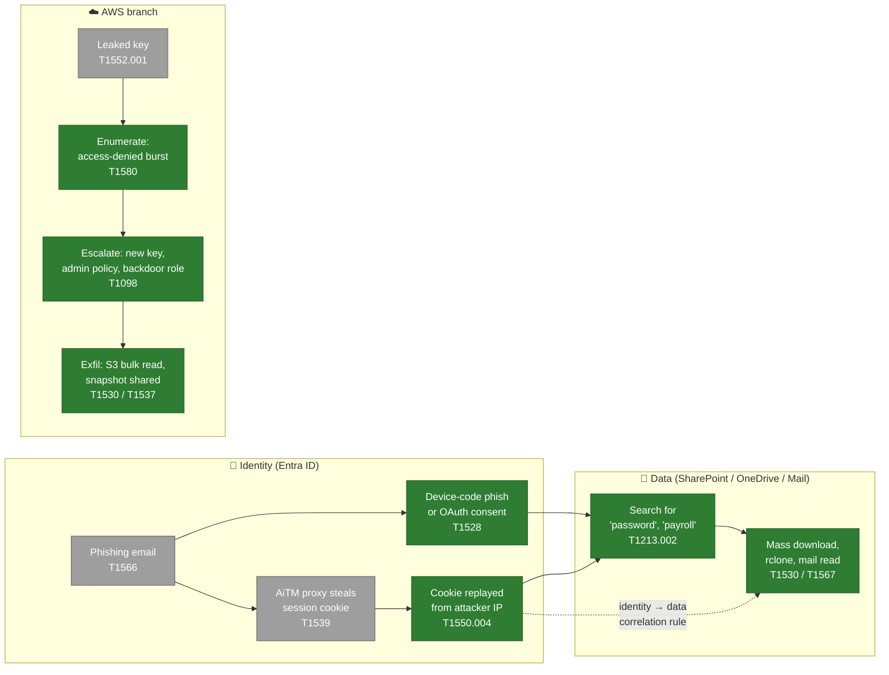
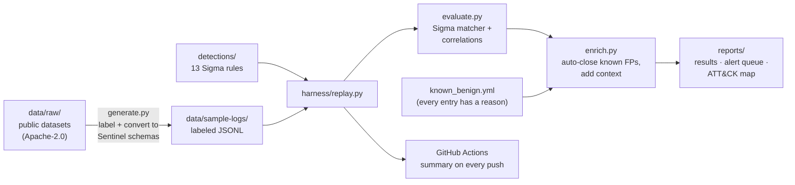

# Identity-to-Data Attack Chain Detection Lab

[](https://github.com/abayate/identity-to-data-lab/actions/workflows/ci.yml)


**Detection-as-code for one attack story, from start to finish:** a stolen Microsoft 365
identity is used to reach company data, and a leaked AWS key goes after the cloud account.
Every detection is a [Sigma](https://sigmahq.io) rule with a Microsoft Sentinel (KQL)
equivalent. Every rule is **proven in CI** against real, published attack telemetry: it has
to fire on the attack and stay quiet on normal activity. An automated triage layer
auto-closes documented false positives and attaches investigation context to the rest.

> **In one sentence:** write a detection, prove it catches the attack and ignores normal
> traffic, and automate the triage. That's this repo.

### 👉 [Open the interactive dashboard](https://abayate.github.io/identity-to-data-lab/)

Press ▶ on a real attack and watch its events stream through the rules, click any log
line to see *why* a rule matched it (field by field), work the analyst queue with the
answer key hidden, and walk the full detection lifecycle. The dashboard is rebuilt from
the real data by CI on every push.

📄 **[Read the findings report](docs/06-findings-report.md)** for results, the tuning
decision, every missed attack event explained, lessons learned, and next steps.

**100% real telemetry:** every event was captured by Splunk's Threat Research Team while real
attack tools ran against real Microsoft 365 and AWS test tenants. Nothing is simulated.

---

## Results at a glance

| | |
|---|---|
| **Detection rules** | 13 Sigma rules (3 identity, 4 data-layer, 6 AWS), each with KQL for Sentinel |
| **Attack data** | 1,611 malicious + 59 benign **real events** from [Splunk's attack_data](https://github.com/splunk/attack_data) (Evilginx, TokenTactics, rclone, Atomic Red Team, Stratus Red Team…) |
| **Whole-chain catch rate** | **97%**: 1,563 of 1,611 malicious events are part of at least one alert |
| **ATT&CK coverage** | 11 of 14 planned techniques **tested** against real attack data (the 3 gaps are steps these logs cannot see) |
| **Auto-triage** | Noisiest rule: **73.7% → 13.2%** false-positive rate, with **zero** real attacks suppressed |
| **Tests** | 200+ pytest checks in ~2 seconds, run on every push; CI also fails if the committed results go stale |
| **Upstream** | One rule submitted to [SigmaHQ](https://github.com/SigmaHQ/sigma): [PR #6501](https://github.com/SigmaHQ/sigma/pull/6501), passing SigmaHQ's own validators ([details](upstream/sigmahq/)) |


*Green = a rule caught real attack telemetry for this technique. Grey = gap. The three gaps
happen where these logs can't see: in the mailbox (the phishing email), on the attacker's
proxy (the cookie theft), and outside AWS (where the key leaks).*

---

## The attack chain and what catches each step



| Step | Rule (click to open) | Fires on | Lab result |
|---|---|---|---|
| Device-code phishing | [`entra_device_code_signin.yml`](detections/entra/entra_device_code_signin.yml) | Sign-in with `AuthenticationProtocol = deviceCode` | 1 TP, 0 FP |
| Illicit OAuth consent | [`entra_oauth_consent_granted.yml`](detections/entra/entra_oauth_consent_granted.yml) | `Consent to application` audit event | 1 TP, 0 FP |
| AiTM cookie replay | [`entra_user_signin_multiple_ips.yml`](detections/entra/entra_user_signin_multiple_ips.yml) | Same user, 2+ IPs within 1h (correlation) | 3 TP, 0 FP |
| Sensitive search | [`m365_sensitive_term_search.yml`](detections/data/m365_sensitive_term_search.yml) | SharePoint / Microsoft Search for credential & payroll terms | 12 TP, 0 FP |
| Mass file access | [`m365_mass_file_access.yml`](detections/data/m365_mass_file_access.yml) | > 20 file reads per user in 10 min | 4 TP, 0 FP |
| rclone exfiltration | [`m365_rclone_download.yml`](detections/data/m365_rclone_download.yml) | `FileDownloaded` with rclone user agent | 58 TP, 0 FP |
| **Identity → data** | [`identity_to_data_access_after_multi_ip_session.yml`](detections/data/identity_to_data_access_after_multi_ip_session.yml) | Multi-IP session **and** file/mail access by the same user within 1h, across two log sources | 1 TP, 0 FP |
| Leaked-key enumeration | [`aws_access_denied_burst.yml`](detections/aws/aws_access_denied_burst.yml) | > 20 access-denied calls per identity in 10 min | 2 TP, 0 FP |
| Key minted for another user | [`aws_access_key_created_for_other_user.yml`](detections/aws/aws_access_key_created_for_other_user.yml) | `CreateAccessKey` where target ≠ caller (`fieldref`) | 28 TP, 28 FP → **5 after triage** |
| Policy rewritten to admin | [`aws_policy_version_grants_wildcard.yml`](detections/aws/aws_policy_version_grants_wildcard.yml) | New default policy version with `"Action": "*"` | 3 TP, 0 FP |
| Backdoor role | [`aws_role_trust_wildcard_or_account.yml`](detections/aws/aws_role_trust_wildcard_or_account.yml) | `CreateRole` trusting `*` or a whole account | 2 TP, 0 FP |
| S3 bulk read | [`aws_s3_mass_getobject.yml`](detections/aws/aws_s3_mass_getobject.yml) | > 50 `GetObject` per identity in 10 min | 1 TP, 0 FP |
| Snapshot exfiltration | [`aws_ebs_snapshot_shared.yml`](detections/aws/aws_ebs_snapshot_shared.yml) | Snapshot shared with another account or public | 6 TP, 0 FP |

Full write-ups (why each rule works, KQL, tuning, and a **GuardDuty vs. custom rules**
comparison) are in [`docs/03-detections.md`](docs/03-detections.md).

> **Honest caveat:** the public datasets contain only 59 benign events, so "0 FP" means
> no false positives *on the data available*, not that a rule will be quiet in production.
> Each rule documents its expected production noise, and two tests deliberately build
> known false positives (a roaming user, a new laptop syncing OneDrive) so those limits stay visible.

---

## How it works



1. **Real attack data, labeled event by event.** [`sources.yml`](simulations/public_datasets/sources.yml)
   lists each public dataset and *why* each event is labeled malicious or benign, citing
   the dataset's own documentation. Labels never use the fields the rules test, and a test
   enforces that, so no rule can score well by reading the answer key.
2. **A small, readable Sigma engine.** [`harness/evaluate.py`](harness/evaluate.py) evaluates
   Sigma directly in Python, including Sigma v2 **correlation rules** (`event_count`,
   `value_count`, `temporal`), **aliases** for joining across log sources, and `fieldref`.
3. **Triage like a SOC.** [`harness/enrich.py`](harness/enrich.py) auto-closes alerts that
   match a documented known-benign pattern and gives every other alert context: is this
   IP / network / country **new for this user**?
4. **Reports for humans.** [`reports/results.md`](reports/results.md) (scores),
   [`reports/alerts.md`](reports/alerts.md) (the analyst queue),
   [`reports/coverage.md`](reports/coverage.md) (ATT&CK map).

<details>
<summary><b>🔍 Click to see a correlation rule: the identity → data link</b></summary>

Either signal alone is ambiguous: roaming users trip the multi-IP rule, and everyone reads
files. Together they mean *a likely-stolen session is collecting data*. The user field is
named differently in each log source, so Sigma `aliases` join them.

```yaml
correlation:
  type: temporal
  rules:
    - entra_user_session_multiple_ips   # itself a correlation rule (Entra sign-ins)
    - m365_user_data_access             # file / mail reads (M365 audit)
  group-by:
    - user
  aliases:
    user:
      entra_user_session_multiple_ips: UserPrincipalName
      m365_user_data_access: UserId
  timespan: 1h
```

In the public Evilginx dataset, the victim's mailbox was read from the replaying IP
**33 seconds** after the attacker's first sign-in from that IP. Tests prove the rule does
**not** fire with only one half present, or when the halves are more than an hour apart.
</details>

<details>
<summary><b>🧹 Click to see the triage story: 73.7% → 13.2% false positives</b></summary>

"Access key created for a different user" caught all 28 attack events, plus 28 admins
doing their jobs. Instead of weakening the rule, one documented entry in
[`known_benign.yml`](harness/known_benign.yml) closes the approved workflow:

```yaml
- name: federated-admins-console-key-provisioning
  reason: >
    The cloud team provisions IAM access keys ... from the AWS console after signing in
    through the company IdP (Okta) into the okta_adm_role admin role ...
  rules:
    - AWS Access Key Created for a Different IAM User
  match:
    userIdentity.type: AssumedRole
    userIdentity.arn|contains: ':assumed-role/okta_adm_role/'
    userAgent: console.amazonaws.com
```

| | Alerts | False positives | FP rate (per benign event) |
|---|---|---|---|
| Raw rule | 56 | 28 | 73.7% |
| After auto-triage | 33 open | 5 | **13.2%** |

The 5 remaining are IAM users creating keys from the CLI. They stay open **on purpose**,
because a stolen admin key would look exactly like them. CI fails if suppression ever closes a
true positive, or if more than 5 false positives are left open.
</details>

<details>
<summary><b>☁️ Click to see GuardDuty vs. custom rules (summary)</b></summary>

| Step | Better coverage | Why |
|---|---|---|
| Key leaked | GuardDuty | Amazon threat intel (`CredentialAccess:IAMUser/CompromisedCredentials`); no CloudTrail event exists for a custom rule |
| Enumeration | Both | Custom catches the noisy denied burst on day one; GuardDuty's ML can catch quiet recon |
| Key for another user | Trade-off | GuardDuty baselines away routine admins; custom is deterministic and explainable |
| Policy → admin | Custom | Custom inspects *what the policy grants*, not just how unusual the call is |
| Backdoor role | Custom (+ IAM Access Analyzer) | No dedicated GuardDuty finding for external trust |
| S3 bulk read | GuardDuty (slightly) | Per-identity and per-bucket baselines; both need S3 data events |
| Snapshot shared | Custom | Worth an alert every time, anomalous or not |

Full table with finding names and reasoning: [`docs/03-detections.md`](docs/03-detections.md#guardduty-vs-custom-rules).
</details>

<details>
<summary><b>🧪 Click to see what the tests enforce</b></summary>

- Every rule has full metadata (UUID, ATT&CK tag, false positives, level) and a KQL section in the docs.
- Every rule **fires on the scenario it was written for** and leaves **no false positives open**
  after triage (one documented exception, capped at 5).
- No rule reads the answer key (`lab_` fields) or any value the labels were built from.
- Auto-close **never** hides a true positive; every known-benign entry is used and has a reason.
- Committed sample logs are byte-identical to what the converter produces (no hand edits).
- The matcher's features (modifiers, conditions, correlations, aliases, `fieldref`) each have unit tests.
- The SigmaHQ-formatted copy of a rule raises exactly the same alerts as the lab version.
- CI regenerates `reports/` and fails if they differ from what's committed, so the numbers in this README can't silently go stale.

Run them: `pytest -v` (200+ tests, ~2 seconds).
</details>

---

## Quick start

```bash
git clone https://github.com/abayate/identity-to-data-lab.git
cd identity-to-data-lab
python -m venv .venv
source .venv/bin/activate          # Windows: .venv\Scripts\activate
pip install -r requirements.txt

pytest -v                          # 200+ tests: every rule vs. real attack data
python harness/replay.py           # per-rule table + writes reports/
python harness/replay.py --open    # ...and opens the interactive dashboard in your browser
python harness/replay.py --regenerate   # rebuild sample logs from raw data first
```

What you'll see from `replay.py` (excerpt):

```
| Rule                                          | Events | Hits | TP | FP | Auto-closed | FP rate | FP rate after triage |
| AWS Access Key Created for a Different IAM User |   1333 |   56 | 28 | 28 |          23 |   73.7% |                13.2% |
| Data Access Within One Hour of a Multi-IP ... |    332 |    1 |  1 |  0 |           0 |    0.0% |                 0.0% |
...
Malicious events caught by at least one rule: 1563 / 1611
```

Every push runs the same thing in GitHub Actions. Open the **Actions** tab, then a run, then
**Summary** to see the tables.

---

## Repository map

```
detections/            13 Sigma rules: entra/, data/, aws/
harness/               evaluate.py (Sigma engine) · enrich.py (triage) · coverage.py · replay.py · dashboard.py
  known_benign.yml     documented auto-close patterns
simulations/
  public_datasets/     sources.yml (datasets + labeling evidence) · fetch.py · generate.py
  aws_keyleak/         how to regenerate the AWS telemetry with Stratus Red Team
  schemas.py           required / optional fields per log type
data/raw/              unmodified public datasets (+ LICENSE, NOTICE)
data/sample-logs/      labeled JSONL the rules run against (generated)
reports/               results, alert queue, ATT&CK coverage (generated); dashboard/ is built by CI
upstream/sigmahq/      rule + PR text prepared for SigmaHQ, validated with their tools
tests/                 200+ pytest checks
docs/                  architecture · detections · go-live · interview prep · replication guide
```

## Documentation

| Doc | What's in it |
|---|---|
| [**Findings report**](docs/06-findings-report.md) | Results, the tuning decision, every miss explained, lessons, next steps |
| [**Interactive dashboard**](https://abayate.github.io/identity-to-data-lab/) | Attack replay, rule explanations, analyst queue, lifecycle, coverage |
| [Architecture](docs/01-architecture.md) | Components, data flow, design decisions |
| [Detections](docs/03-detections.md) | Every rule: logic, KQL, tuning, results; GuardDuty comparison |
| [Go-live](docs/05-go-live.md) | Pointing the same rules at a real Entra tenant (Sentinel) and AWS account |
| [Replication guide](docs/REPLICATION-GUIDE.md) | Rebuild the whole project step by step, with expected output |
| [Interview prep](docs/interview-prep.md) | Plain-English walkthrough of every phase + practice questions |

## Design decisions and limitations

- **Real public data instead of invented logs.** Splunk's attack_data captures real tools in a
  test tenant. The trade-off: datasets come from different tenants and runs, so the full
  chain exists end to end only for the Evilginx → mailbox case. Other steps are tested one at a time.
- **Small benign baseline (59 events).** Enough to prove the pipeline, not to claim production
  FP rates. The fix is exporting normal activity from your own test tenant (see go-live).
- **Own minimal Sigma engine.** pySigma converts rules to SIEM queries; it doesn't evaluate them
  in Python. The engine implements only the subset these rules use, and says so.
- **Sigma can't express everything.** For example, "trusted account ≠ this account" in the
  role-trust rule. The KQL versions go further where KQL can, and the docs say which is stricter.

## Credits and licensing

Attack telemetry: [Splunk Threat Research Team, attack_data](https://github.com/splunk/attack_data),
Apache License 2.0. Unmodified copies with LICENSE and NOTICE are in [`data/raw/`](data/raw/splunk_attack_data/);
the labeled versions in `data/sample-logs/` are derivative works under the same license.
Rule format: [Sigma](https://github.com/SigmaHQ/sigma-specification). Emulation tooling referenced:
[Stratus Red Team](https://stratus-red-team.cloud/).
