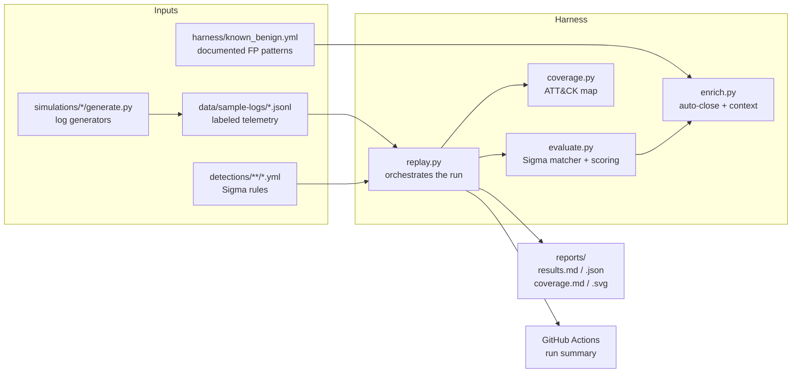

# Architecture

## Overview

The lab is a detection pipeline that runs on a laptop or in CI. Log generators
produce labeled synthetic telemetry, Sigma rules describe what to look for, and a
small Python harness runs every rule against the logs, scores it, triages the hits,
and reports coverage. Nothing talks to a live cloud account. The same rules move to
a real tenant later (see `05-go-live.md`).

## Components

### Simulations

`simulations/<module>/` holds one generator per telemetry source. Each one writes
JSON Lines into `data/sample-logs/` using the real field names of the source it
imitates (Entra `SigninLogs`, M365 unified audit log, CloudTrail), plus two answer-key
fields, `lab_label` (`benign` / `malicious`) and `lab_scenario`. Generators use a fixed
random seed, so their output is reproducible and can be committed.

`simulations/entra_aitm/schema.py` is the contract for sign-in records. Both the
generator and `tests/test_sample_logs.py` use it, so the format has a single source
of truth.

### Detections

Sigma YAML rules, one file per rule, grouped by source: `detections/entra/`,
`detections/data/`, `detections/aws/`. Each rule declares:

- `logsource.service`, which decides which log files it runs against
- `tags` with ATT&CK technique ids, which drive the coverage map
- `detection`, the selections and condition the matcher evaluates

Each rule has a KQL equivalent in `03-detections.md` for deployment to Sentinel.

### Harness

| Module | Responsibility | Key functions |
|---|---|---|
| `evaluate.py` | Evaluate a Sigma `detection` block against one record; score TP / FP | `load_rules`, `rule_matches`, `find_hits`, `score_rule` |
| `enrich.py` | Auto-close known-benign hits (reason required); add user-history context to the rest | `load_known_benign`, `triage`, `build_context` |
| `coverage.py` | Map rule tags to planned ATT&CK techniques: tested / untested / gap | `build_coverage`, `coverage_markdown`, `coverage_svg` |
| `replay.py` | Load everything, run all rules, write `reports/`, post the CI summary | `main`, `evaluate_all`, `chain_coverage` |

## Data flow

1. **Generate** (optional, `replay.py --regenerate`): each `simulations/*/generate.py`
   rewrites its file in `data/sample-logs/`.
2. **Load**: `replay.py` groups log records by file prefix (`entra_signins`,
   `m365_audit`, `cloudtrail`, ...) and loads every rule in `detections/`.
3. **Route**: each rule only sees the records for its `logsource.service`
   (`SERVICE_TO_FILE_PREFIX`), so a sign-in rule can never fire on a CloudTrail event.
4. **Match and score**: `evaluate.py` finds the hits; the `lab_label` of each hit makes
   it a true or false positive.
5. **Triage**: `enrich.py` auto-closes hits matching `known_benign.yml` and attaches
   context to the rest. This gives the FP rate before and after triage.
6. **Report**: per-rule results, whole-chain catch rate (malicious events caught by
   at least one rule), and the ATT&CK coverage map go to `reports/` and, in CI, to the
   Actions run summary.

## Design decisions

- **Synthetic, labeled logs instead of a live tenant:** reproducible, free, safe, and
  the ground truth is known, so TP / FP rates are measurable.
- **Own minimal Sigma matcher instead of pySigma:** pySigma converts rules to SIEM
  queries; it doesn't evaluate them in Python. The matcher supports only the subset
  the rules use, and says so.
- **Rules never read `lab_` fields:** the answer key is for scoring only.
- **No per-rule false negatives:** each rule covers one chain step, so misses are
  measured across all rules together.
- **Standard library + PyYAML + pytest only:** every line is explainable.
