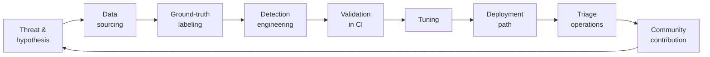

# Findings Report: Identity-to-Data Detection Engineering

**Author:** Anthony Bayate Jr. · **Date:** October 2026 ·
**Repo:** https://github.com/abayate/identity-to-data-lab ·
**Interactive results:** https://abayate.github.io/identity-to-data-lab/

---

## 1. Executive summary

Most intrusions into cloud companies now start with an identity, not malware: a session
cookie stolen by an adversary-in-the-middle proxy, a user tricked into a device-code or
OAuth-consent prompt, or a cloud access key that leaked. What matters next is the data
that identity can reach.

This project built and validated detections for that path, from stolen identity to the
data it reaches, plus the parallel AWS key-leak path, using **only real attack telemetry**
(1,670 events published by Splunk's Threat Research Team, captured while real attack tools
ran against real Microsoft 365 and AWS test tenants).

| Result | Value |
|---|---|
| Detections built | 13 Sigma rules (3 identity, 4 data, 6 AWS), each with a Sentinel KQL version |
| Attack events caught | **1,563 of 1,611 (97%)** are part of at least one alert |
| False positives left for analysts | 5, all from one rule, documented and capped in CI |
| Noisiest rule, after tuning | **73.7% → 13.2%** false-positive rate, with zero attacks suppressed |
| ATT&CK coverage | 11 of 14 planned techniques proven on real data; the 3 gaps are explained |
| Community | Strongest novel rule submitted to SigmaHQ ([PR #6501](https://github.com/SigmaHQ/sigma/pull/6501)) after passing SigmaHQ's own validators |

**Key finding:** a single-signal rule is either noisy or blind. The highest-value detection
in the project combines two weak signals across two log sources: "this session looks
replayed from a second IP" (Entra ID) **and** "that user is reading files or mail"
(Microsoft 365), within the same hour. On the real Evilginx dataset it fired once: on the
phished user, whose mailbox was read from the replaying IP 33 seconds after the attacker
first signed in from it. Neither signal alone would justify paging someone. Together they
mark the moment an identity incident became a data breach.

---

## 2. Scope and approach

**In scope:** Microsoft Entra ID sign-in and audit logs, Microsoft 365 unified audit
(SharePoint / OneDrive / Exchange), AWS CloudTrail.
**Out of scope:** email security (where phishing is delivered), endpoint telemetry, network
traffic.

The work followed a standard detection lifecycle:

---

## 3. Data

| Source | Datasets | Events | Attack | Normal |
|---|---|---|---|---|
| Entra ID (sign-ins, audit) | 4 | 48 | 39 | 9 |
| Microsoft 365 (SharePoint, OneDrive, Exchange) | 3 | 289 | 277 | 12 |
| AWS CloudTrail | 6 | 1,333 | 1,295 | 38 |
| **Total** | **12** (one spans two sources) | **1,670** | **1,611** | **59** |

**Labeling decision:** each dataset file mixes the attack with ordinary activity (the
victim's own sign-ins, normal users opening files, admins doing routine IAM work). Events
were labeled one by one from the dataset author's documentation: which IPs and accounts
the attack used. They were never labeled from the fields the rules test, because a rule
graded against its own logic always scores 100% and proves nothing. Ten events that couldn't
be attributed with confidence were **excluded** rather than guessed. Every decision is written
next to its evidence in [`sources.yml`](../simulations/public_datasets/sources.yml).

**Data-quality issues found in real telemetry,** none of which synthetic data would have shown:
- Three timestamp formats, including 7 fractional digits that Python can't parse.
- Required-looking fields missing (service-principal sign-ins have no user).
- One published event truncated mid-JSON (skipped and counted, not crashed on).
- The raw Azure export nests fields in camelCase, while Sentinel's tables use flat
  PascalCase, so a rule written against one silently misses the other.

---

## 4. Detections

| Stage | Detection | Logic type | Result on real data |
|---|---|---|---|
| Identity | Device-code sign-in | single event | 1 TP, 0 FP |
| Identity | OAuth consent granted | single event | 1 TP, 0 FP |
| Identity | Same user, multiple IPs within 1h (session replay) | distinct-value correlation | 3 TP, 0 FP |
| Data | Sensitive-term search in SharePoint / Microsoft Search | single event | 12 TP, 0 FP |
| Data | Mass file access or download | count correlation | 4 TP (every exfil method in the data), 0 FP |
| Data | rclone downloads | single event | 58 TP, 0 FP |
| **Identity → data** | **Replayed session + data access, same user, 1h** | **cross-source temporal correlation** | **1 TP, 0 FP** |
| AWS | Burst of access-denied calls (key enumeration) | count correlation | 2 TP, 0 FP |
| AWS | Access key created for a different user | single event + field comparison | 28 TP, 28 FP → 5 after triage |
| AWS | Policy version rewritten to wildcard actions | single event | 3 TP, 0 FP |
| AWS | Role created trusting `*` or a whole account | single event | 2 TP, 0 FP |
| AWS | S3 mass object download | count correlation | 1 TP, 0 FP |
| AWS | EBS snapshot shared out | single event | 6 TP, 0 FP |

Full logic, KQL, tuning guidance and per-rule results: [`03-detections.md`](03-detections.md).

**Missed attack events: all 48 of 1,611, by cause.**

| Missed | What they are | Why no rule fired | Fix |
|---|---|---|---|
| 27 | Attacker searches in SharePoint / Exchange using ordinary words ("ceo", "money", "documents") | The search rule only looks for sensitive *terms* | **Real gap:** add a search-*volume* rule (one user, many searches in minutes). The dataset was built to show both patterns. |
| 15 | Identity events around the attacks: failed MFA / consent prompts, M365 `UserLoggedIn` records, the consent's companion audit events (service principal created, permission granted) | Each looks routine on its own. The rules fire on the decisive event of each attack (the device-code token, the consent, the multi-IP session) | Acceptable: each attack still raised its alert |
| 3 | `CreateAccessKey` attempts that were denied and named no target user | The rule only flags keys created *for someone else* | Covered in practice by the access-denied burst rule's pattern |
| 3 | Snapshot attack setup and cleanup (`CreateSnapshot`, removing public access, an empty "add") | None of them shares data | Acceptable: the actual sharing events were all caught |

---

## 5. Tuning: the decision that mattered most

The "access key created for a different user" rule caught all 28 attack events, and it also
fired on 28 routine admin actions in the same account (a 73.7% false-positive rate on
benign events).

Options considered:
1. **Raise the threshold or narrow the rule** (e.g. ignore console activity): rejected. It
   would also blind the rule to an attacker using a stolen admin's console session.
2. **Drop the rule:** rejected. Minting keys for other users is a known escalation and
   persistence path, and the attack data proves it happens.
3. **Document the approved workflow and auto-close only that** ✅: 23 of the 28 false
   positives were admins signing in through the company IdP (Okta) into a dedicated admin
   role and creating keys from the console. One `known_benign.yml` entry, with a written
   reason, closes exactly those.

**Outcome:** 13.2% false-positive rate for analysts, and **zero true positives suppressed**.
Two CI tests lock this in: suppression may never close an alert containing an attack event,
and open false positives for this rule may not exceed 5. The remaining 5 stay open on
purpose: they're CLI key creations by individual IAM users, which is exactly what a stolen
admin key would look like.

---

## 6. Managed detection vs. custom rules (AWS)

GuardDuty, AWS's managed threat-detection service, and custom rules are complements, not
substitutes:
- **GuardDuty wins** where you can't write a rule: threat intelligence (known-compromised
  keys, malicious IPs) and per-identity behavioral baselines. It's the only option for
  the key-leak step itself, which happens outside AWS.
- **Custom rules win** where the *content* of the API call is the signal (what a policy
  grants, which account a role trusts, where a snapshot is shared), and where you need
  deterministic, explainable, CI-tested behavior.

Full step-by-step comparison: [`03-detections.md`](03-detections.md#guardduty-vs-custom-rules).

---

## 7. What went wrong, and what it taught

| Problem | Impact | Fix / lesson |
|---|---|---|
| Labels drawn from the dataset documentation still needed judgment calls | Risk of "ground truth" that's really my guess | Exclude unattributable events; write evidence next to every labeling rule |
| A test I wrote expected no alert 54 minutes into a 1-hour window | Test failed although the rule was right | Check which side is wrong before changing code |
| Correlation over 1,150 events made the test suite 20x slower (42s) | CI friction | Two-pointer sliding window + ID sets → 2s |
| My regex for wildcard policies only checked the first list entry | A real detection gap | Found while preparing the upstream PR; fixed and pinned with 6 test cases |
| I reported "12 of 15" ATT&CK techniques in early docs | Overstated coverage | Caught by the dashboard's live count (11 of 14); corrected everywhere |
| Published reports leaked a local file path | Minor privacy issue | Repo-relative paths, plus a CI check that reports match a fresh run |

---

## 8. Limitations

- **Small benign baseline (59 events):** "0 false positives" means none on the available
  data, not none in production. Two tests deliberately build known false positives (a roaming
  user, a new laptop syncing OneDrive) so these limits stay visible.
- **Datasets come from different tenants:** the full identity → data chain exists end to end
  in one dataset (Evilginx → mailbox). Other steps are validated individually.
- **No live deployment yet:** the rules ship with KQL and a go-live guide, but haven't run
  against a production tenant.

---

## 9. Recommendations and next steps

1. **Search-volume rule:** close the biggest miss (27 attacker searches with ordinary words)
   with a count correlation on search operations per user.
2. **Benign baseline:** export a week of normal activity from a Microsoft 365 developer
   tenant and re-measure every rule's false-positive rate.
3. **Live validation:** run Stratus Red Team in a throwaway AWS account with GuardDuty
   enabled, and fill the "actually fired?" column of the comparison.
4. **Session-level replay detection:** with live data that includes `SessionId`, group the
   multi-IP rule by session instead of user, which is far less noisy than per-user grouping.
5. **Close the coverage gaps** by adding mail-flow logs (phishing delivery, T1566).
6. **Land the SigmaHQ PR** and respond to reviewer feedback.
