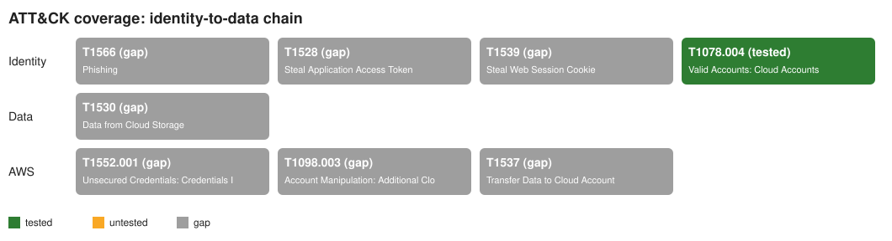

# Replication Guide: Identity-to-Data Detection Lab

This is the step-by-step record of how this project was built, written so you can
rebuild it from an empty folder later, or pick it up where it stopped. It's a
Markdown file (plain text with light formatting). It reads fine in Notepad, and on
GitHub it renders with tables and headings.

"What you should see" blocks are the real terminal output captured while building.
They're your screenshots: if your output matches, the step worked.

---

## 0. Where the project stands right now

| Piece | Status | Where |
|---|---|---|
| Repo scaffold, CI, doc skeletons | Built, committed | Phase 0 |
| Sign-in log schema (field list) | Built | `simulations/entra_aitm/schema.py` |
| Sample-log validator tests | Built (skip until logs exist) | `tests/test_sample_logs.py` |
| Sigma rule engine (matcher + scoring) | Built, tested | `harness/evaluate.py` |
| Auto-triage (FP auto-close + context) | Built, tested | `harness/enrich.py`, `harness/known_benign.yml` |
| ATT&CK coverage map (markdown + SVG) | Built, tested | `harness/coverage.py` |
| Replay runner + report files + CI summary | Built, tested | `harness/replay.py`, `reports/` |
| Threat-model write-up | **Not built: your step** | `docs/02-threat-model.md` |
| Attack + benign log generator | **Not built: your step** | `simulations/entra_aitm/generate.py` |
| Entra / data / AWS detection rules | **Not built: needs the logs above first** | `detections/` |
| Stratus Red Team AWS module | **Not built: you run it against your own AWS account** | `simulations/aws_keyleak/` |
| Runbooks, go-live doc, README | **Not built: Phase 6, written last** | `docs/`, `README.md` |

**Why the attack-side pieces are left to you:** the tooling (the engine, triage,
coverage and reporting) is finished and tested. The generator that produces the
attack-side telemetry, and the threat-model write-up that goes with it, are the
parts I didn't write. Section 7 shows exactly how to build them so they plug in.

Current test result: **66 passed, 2 skipped** (the 2 skipped are waiting for sample logs).

---

## 1. Prerequisites (one-time setup)

1. **Python 3.11 or newer.** Check with `python --version`. (Built with 3.14 locally;
   CI uses 3.12. Both work.)
2. **Git.** Check with `git --version`.
3. **A GitHub account** (for CI and showing the project).
4. A terminal. On Windows, PowerShell or Git Bash both work.

---

## 2. Rebuild from scratch: Phase 0, the scaffold

### Step 2.1: Create the folders

```
identity-to-data-lab/
  .github/workflows/   docs/   detections/entra/   detections/data/   detections/aws/
  simulations/entra_aitm/   simulations/data_exfil/   simulations/aws_keyleak/
  data/sample-logs/   harness/   tests/
```

Empty folders aren't tracked by git, so put an empty `.gitkeep` file in each one
that has nothing else yet.

### Step 2.2: Create the config files

- `requirements.txt`, two lines: `pyyaml>=6.0` and `pytest>=8.0`
- `pyproject.toml`:
  ```toml
  [tool.pytest.ini_options]
  pythonpath = ["."]      # lets tests do `import harness` from the repo root
  testpaths = ["tests"]
  ```
- `.gitignore`: `__pycache__/`, `*.py[cod]`, `.venv/`, `.pytest_cache/`, `.env`, `*.log`
- `.github/workflows/ci.yml`: see the file in this repo. It checks out the code,
  installs Python 3.12, runs `pip install -r requirements.txt`, `pytest -v`, then
  `python harness/replay.py`.

### Step 2.3: Make a virtual environment and install dependencies

```
python -m venv .venv
.venv\Scripts\activate          # Windows PowerShell
source .venv/Scripts/activate   # Git Bash on Windows
source .venv/bin/activate       # Mac / Linux
pip install -r requirements.txt
```

### Step 2.4: Git init and first commit

```
git init
git add -A
git commit -m "Phase 0: scaffold repo structure, CI stub, doc skeletons"
```

**Gotcha we hit:** `pytest` with zero tests exits with code 5, which CI treats as a
failure. The fix was a real smoke test (`tests/test_harness.py`) that checks every
folder exists and every harness module has a docstring.

---

## 3. Phase 1 groundwork: the log schema and validator

### Step 3.1: Define the schema

`simulations/entra_aitm/schema.py` holds `REQUIRED_FIELDS`, a dict of field name to
Python type. The field names copy Microsoft's real `SigninLogs` table
(`UserPrincipalName`, `IPAddress`, `AutonomousSystemNumber`, `AuthenticationRequirement`,
`IncomingTokenType`, `SessionId`, ...), so rules transfer to a real tenant later.

Two lab-only fields are the **answer key**:
- `lab_label`: `"benign"` or `"malicious"`
- `lab_scenario`: which story produced the event (e.g. `"normal_workday"`)

Rules must never read `lab_` fields, or the rules would be cheating.

Add empty `__init__.py` files (with a one-line docstring) in `simulations/` and
`simulations/entra_aitm/` so the tests can import the schema.

### Step 3.2: Validator tests

`tests/test_sample_logs.py` reads every `data/sample-logs/entra_signins*.jsonl`
file and checks each line is JSON, has every field with the right type, has a
valid label and an ISO 8601 timestamp, and that both labels appear somewhere.

The file also tests its **own checker** with known-bad records. Otherwise a buggy
checker could pass everything silently.

**Log format: JSON Lines.** One event per line, for example:
```
{"TimeGenerated": "2026-10-01T14:03:22Z", "UserPrincipalName": "alice@contoso.example", ...}
{"TimeGenerated": "2026-10-01T14:05:10Z", "UserPrincipalName": "bob@contoso.example", ...}
```

---

## 4. The Sigma rule engine (`harness/evaluate.py`)

A ~200-line matcher that evaluates a Sigma rule's `detection:` block directly
against each log record. No SIEM needed.

Supports:
- Selections: fields in one map are AND, a list of values is OR, a list of maps is OR
- Modifiers: `contains`, `startswith`, `endswith`, `re`, `gt`, `gte`, `lt`, `lte`, `all`
- Nested fields with dots (`userIdentity.type`), needed for CloudTrail
- `null` meaning "field missing or empty"
- Conditions: `and`, `or`, `not`, parentheses, `1 of name*`, `all of name*`
- Case-insensitive string matching (per the Sigma spec)

Key functions: `load_rule`, `load_rules`, `rule_matches`, `find_hits`, `score_rule`.

Tests: `tests/test_evaluate.py` covers each feature separately with toy rules.

---

## 5. Triage, coverage and replay (`harness/enrich.py`, `coverage.py`, `replay.py`)

### enrich.py: auto-triage
- `harness/known_benign.yml` is a list of expected, harmless patterns. **Each entry
  needs a written `reason`** (the loader refuses entries without one). Entries use
  Sigma selection syntax and can be limited to specific rules with `rules:`.
- A hit matching an entry becomes `auto_closed`. Every other hit becomes `open` with
  context: how many other events the user has, and whether this IP / ASN / country
  is **new for that user**.

### coverage.py: ATT&CK map
- Reads `attack.tXXXX` tags from each rule.
- Compares them with `PLANNED_TECHNIQUES`, the techniques this chain should cover.
- Statuses: **tested** (a rule caught real attack events), **untested** (a rule
  exists but caught nothing), **gap** (no rule).
- Writes a markdown table and an SVG picture.

### replay.py: the runner
- Loads all logs and all rules, runs each rule only against its own log type
  (`logsource: service:` → file prefix, e.g. `signinlogs` → `entra_signins*.jsonl`),
  scores, triages, and writes `reports/results.md`, `results.json`, `coverage.md`, `coverage.svg`.
- `--regenerate` first re-runs every `simulations/*/generate.py`.
- In GitHub Actions it also writes the tables to the run's **Summary** page.

### Step 5.1: Run it

```
python harness/replay.py
```

**What you should see right now (no rules or logs yet):**
```
Loaded 0 log events and 0 rules.

| Rule | Events | Hits | TP | FP | Auto-closed | FP rate | FP rate after triage |
|---|---|---|---|---|---|---|---|
| (no rules in detections/ yet) | - | - | - | - | - | - | - |

**Malicious events caught by at least one rule:** 0 / 0

| Branch | Technique | Name | Status | Rules |
|---|---|---|---|---|
| Identity | T1566 | Phishing | gap | - |
| Identity | T1528 | Steal Application Access Token | gap | - |
| Identity | T1539 | Steal Web Session Cookie | gap | - |
| Identity | T1078.004 | Valid Accounts: Cloud Accounts | gap | - |
| Data | T1530 | Data from Cloud Storage | gap | - |
| AWS | T1552.001 | Unsecured Credentials: Credentials In Files | gap | - |
| AWS | T1098.003 | Account Manipulation: Additional Cloud Roles | gap | - |
| AWS | T1537 | Transfer Data to Cloud Account | gap | - |

Reports written to ...\reports
```

### Step 5.2: Proof it works, on toy data

The test suite builds a tiny lab in a temp folder: one toy rule, four events (one
malicious, one benign scanner that trips the rule, two normal), and one
known-benign entry for the scanner. Running replay on it gave:

```
Loaded 4 log events and 1 rules.

| Rule | Events | Hits | TP | FP | Auto-closed | FP rate | FP rate after triage |
|---|---|---|---|---|---|---|---|
| Toy rule - sign-in from test network | 4 | 2 | 1 | 1 | 1 | 33.3% | 0.0% |

**Malicious events caught by at least one rule:** 1 / 1
```

Read it like this: the rule fired twice. One hit was the attack (TP). One was the
scanner (FP), which the known-benign list auto-closed, so the FP rate an analyst
actually sees dropped from 33.3% to 0%. **That before/after number is the headline
result for interviews.**

The coverage map it drew (T1078.004 shows as tested):



### Step 5.3: Run the tests

```
pytest -v
```

**What you should see (end of output):**
```
66 passed, 2 skipped
```

---

## 6. How to see the results (for you, GitHub, and your resume)

| Where | How | Who it's for |
|---|---|---|
| Terminal | `pytest -v` and `python harness/replay.py` | You, while building |
| `reports/` folder | Committed files; GitHub renders `results.md` and `coverage.svg` in the browser | Anyone browsing the repo |
| GitHub Actions | Repo → **Actions** tab → click a run → **Summary** shows the replay tables | Proof it runs automatically |
| README (Phase 6) | Pitch, diagram, coverage map, results table, CI badge | Recruiters |

### Putting it on GitHub (not done yet: there's no remote)

1. On github.com: **New repository** → name `identity-to-data-lab` → don't add a README.
2. In the project folder:
   ```
   git remote add origin https://github.com/<your-username>/identity-to-data-lab.git
   git push -u origin main
   ```
3. Open the **Actions** tab and watch the first run go green.
4. Add the badge to the README later:
   ``

---

## 7. What's left, and exactly how to do it

### 7.1 Threat model (`docs/02-threat-model.md`)
Fill in the existing headings in your own words: for each chain step, the ATT&CK ID
(they're listed in `harness/coverage.py`), what the attacker achieves, and **which
log fields would show it**. Writing this yourself is the best interview prep there
is. MITRE's pages (attack.mitre.org) and Microsoft's Entra sign-in log docs are the
sources to cite.

### 7.2 Sign-in log generator (`simulations/entra_aitm/generate.py`)
Requirements it must meet so everything else plugs in:
- Writes `data/sample-logs/entra_signins.jsonl`, one JSON object per line.
- Every record has every field in `REQUIRED_FIELDS` (import it from `schema.py`).
- Uses `random.seed(<fixed number>)` so output is identical on every run.
- Uses only documentation IP ranges (`192.0.2.x`, `198.51.100.x`, `203.0.113.x`),
  private ASNs (64512–65534), and a fake domain (`contoso.example`). No real data.
- Produces mostly benign events (normal users, normal times, known devices) plus a
  small, labeled set of malicious ones. Every event gets `lab_label` and `lab_scenario`.
- Runnable as `python -m simulations.entra_aitm.generate`, so `replay.py --regenerate` finds it.

When it's done: `pytest` should show **0 skipped** (the sample-log tests run), and
they must pass.

### 7.3 Detection rules (`detections/entra/*.yml`)
Skeleton every rule follows:
```yaml
title: <what it detects>
id: <a UUID: python -c "import uuid; print(uuid.uuid4())">
status: experimental
description: <one or two sentences>
logsource:
  product: azure
  service: signinlogs          # must match SERVICE_TO_FILE_PREFIX in replay.py
tags:
  - attack.<tactic_name>
  - attack.tXXXX.XXX           # drives the coverage map
detection:
  selection:
    FieldName: value
  condition: selection
falsepositives:
  - <what legit activity could trip it>
level: medium
```
For each rule, add tests in `tests/test_detections.py`: it fires on its malicious
events and stays silent on benign ones. Use `find_hits` / `score_rule` from
`harness/evaluate.py`. Then add the KQL equivalent and a writeup in `docs/03-detections.md`.

### 7.4 Phases 3, 4, 6, 7
Follow `CLAUDE.md` section 5. Notes:
- Data-layer logs go in `data/sample-logs/m365_audit*.jsonl` (`service: m365`).
- CloudTrail logs go in `data/sample-logs/cloudtrail*.jsonl` (`service: cloudtrail`).
  Generate them with Stratus Red Team (github.com/DataDog/stratus-red-team) in **your
  own throwaway AWS account**, then label each event and commit it.
- If a new log type needs a new prefix, add it to `SERVICE_TO_FILE_PREFIX` in `replay.py`.

---

## 8. Feedback and lessons learned (things that bit us)

1. **Empty test suites fail CI.** pytest exit code 5. Fix: write a real smoke test, not a flag.
2. **CRLF warnings on Windows** ("LF will be replaced by CRLF") are harmless; CI runs on Linux.
3. **Test your tests.** The validator and the matcher both have tests that feed them
   known-bad input. A checker that accepts everything is worse than no checker.
4. **Run rules only on their own log type.** Without the `logsource` → file mapping,
   a sign-in rule could "fire" on a CloudTrail event that happens to share a field
   name. There's a test for this (`test_rule_ignores_other_log_types`).
5. **Don't count per-rule false negatives.** Each rule covers one step, so whole-chain
   coverage is measured across all rules ("caught by at least one rule").
6. **Every auto-close needs a reason.** The loader enforces it. In a real SOC, an
   unexplained suppression is how a real attack gets dismissed.
7. **Answer-key fields are prefixed `lab_`** so a rule that cheats is obvious in review.
8. **Fixed random seeds** keep generated logs identical across runs, so test results
   don't flicker.

---

## 9. Command cheat sheet

| Task | Command |
|---|---|
| Activate venv (PowerShell) | `.venv\Scripts\activate` |
| Install deps | `pip install -r requirements.txt` |
| Run tests | `pytest -v` |
| Run the harness | `python harness/replay.py` |
| Regenerate logs, then run | `python harness/replay.py --regenerate` |
| Commit a phase | `git add -A` then `git commit -m "Phase N: ..."` |
| Push to GitHub | `git push` |
