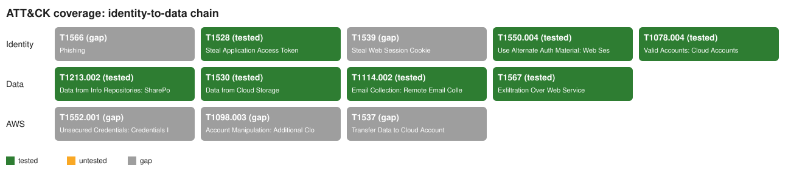

# ATT&CK coverage

| Branch | Technique | Name | Status | Rules |
|---|---|---|---|---|
| Identity | T1566 | Phishing | gap | - |
| Identity | T1528 | Steal Application Access Token | tested | Entra ID Sign-In Using Device Code Flow, Entra ID User Consent Granted to an Application |
| Identity | T1539 | Steal Web Session Cookie | gap | - |
| Identity | T1550.004 | Use Alternate Auth Material: Web Session Cookie | tested | Entra ID User Session Active From Multiple IPs Within One Hour |
| Identity | T1078.004 | Valid Accounts: Cloud Accounts | tested | AWS Burst of Access-Denied API Calls by One Identity, AWS IAM Policy Version Set as Default With Wildcard Actions, Data Access Within One Hour of a Multi-IP Entra Session, Entra ID User Session Active From Multiple IPs Within One Hour |
| Data | T1213.002 | Data from Info Repositories: SharePoint | tested | M365 Search for Credential or Payroll Terms |
| Data | T1530 | Data from Cloud Storage | tested | AWS S3 Mass Object Download by One Identity, Data Access Within One Hour of a Multi-IP Entra Session, M365 Mass File Access or Download by One User, M365 File Download With Rclone User Agent |
| Data | T1114.002 | Email Collection: Remote Email Collection | tested | Data Access Within One Hour of a Multi-IP Entra Session |
| Data | T1567 | Exfiltration Over Web Service | tested | M365 Mass File Access or Download by One User, M365 File Download With Rclone User Agent |
| AWS | T1552.001 | Unsecured Credentials: Credentials In Files | gap | - |
| AWS | T1580 | Cloud Infrastructure Discovery | tested | AWS Burst of Access-Denied API Calls by One Identity |
| AWS | T1098.001 | Account Manipulation: Additional Cloud Credentials | tested | AWS Access Key Created for a Different IAM User |
| AWS | T1098.003 | Account Manipulation: Additional Cloud Roles | tested | AWS IAM Policy Version Set as Default With Wildcard Actions, AWS IAM Role Created Trusting Any Principal or a Whole Account |
| AWS | T1537 | Transfer Data to Cloud Account | tested | AWS EBS Snapshot Shared With Another Account or Made Public |
